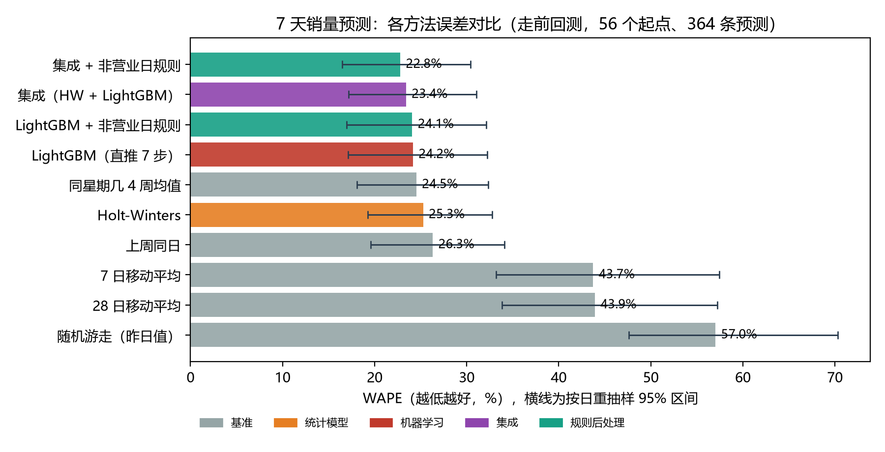
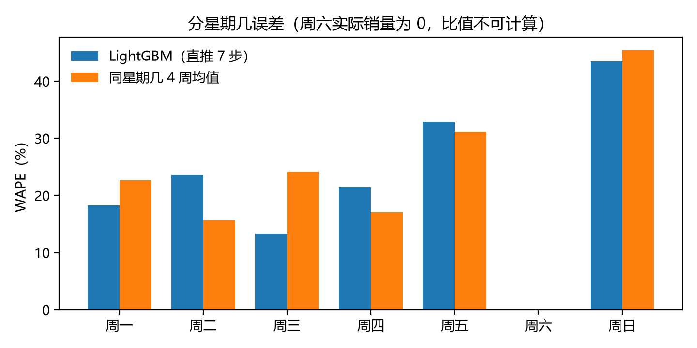
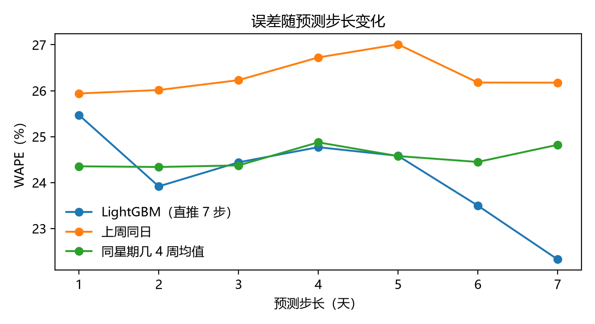

# 电商日销量 7 天预测：方法对比实验结果

生成时间：2026-10-19　｜　数据：Online Retail II（UCI，CC BY 4.0）　｜　脚本：`run_benchmark.py`

本文件的所有数字由 `run_benchmark.py` 计算，`results/` 下的 CSV、`figures/` 下的图可重新生成。走缓存时全程约 28 秒，首次运行需多花约 37 秒读取原始 Excel。

---

## 1. 一句话结论

在 739 天、单店日总销量、7 天预测范围的条件下，**方法之间的真正分水岭是"有没有用上星期几的结构"，不是模型复杂度**：

- 带上周内结构的方法（LightGBM / Holt-Winters / 同星期几均值 / 上周同日）误差都在 **24%–26%**；
- 不带周内结构的平滑方法（7 日、28 日移动平均）误差 **44%**，随机游走 **57%**；
- LightGBM 比"同星期几 4 周均值"低 0.34 个百分点（24.17% vs 24.52%），但自助法 95% 区间为 **[−4.7, +4.5] 个百分点，跨过 0**，在 8 周测试上**不能宣称显著更优**；
- 剔除 2011-12-09 这一天的单笔大单后，主要方法误差降到 **19.5%–21.2%**，说明尾部误差由个别异常日主导。

因此，报告里应当写"机器学习与强基准相当、组合使用略有收益"，而不是"机器学习显著优于基准"。

## 2. 实验口径

| 项目 | 设定 |
|---|---|
| 序列 | 每日总销量＝正数量、非取消明细的 Quantity 求和；无记录日补 0 |
| 口径细节 | 剔除 `Invoice` 以 C 开头的取消单；不剔除批发大单（见第 5 节说明） |
| 区间 | 2009-12-01 至 2011-12-09，共 739 天（135 天零销量，主要是周六） |
| 切分 | 训练 2009-12-01–2011-08-15；验证 2011-08-16–2011-10-14；测试 2011-10-15–2011-12-09 |
| 预测任务 | 未来 7 天，逐日多步；测试期每个日历日为起点（56 个），共 364 条预测 |
| 训练方式 | 走前回测：每个起点只用该日及以前的数据重训，特征不含未来信息 |
| 指标 | MAE、RMSE、WAPE（Σ|误差|/Σ实际）、偏差%；WAPE 用按目标日 2000 次重抽样给 95% 区间 |
| 验证集用途 | 只决定一件事：树模型目标是否做 log1p（结果：不做更好，WAPE 30.2% vs 30.8%） |

## 3. 结果

| 方法 | 类别 | MAE | WAPE | 95% 区间 | 偏差 |
|---|---|---|---|---|---|
| 集成 + 非营业日规则 | 规则后处理 | 5929 | **22.8%** | 16.5%–30.4% | −5.2% |
| 集成（HW + LightGBM） | 集成 | 6092 | 23.4% | 17.2%–31.0% | −4.6% |
| LightGBM + 非营业日规则 | 规则后处理 | 6268 | 24.1% | 17.0%–32.1% | −3.1% |
| LightGBM（直推 7 步） | 机器学习 | 6289 | 24.2% | 17.1%–32.3% | −3.0% |
| 同星期几 4 周均值 | 基准 | 6384 | 24.5% | 18.1%–32.4% | −11.5% |
| Holt-Winters（加法，周季节） | 统计模型 | 6576 | 25.3% | 19.3%–32.8% | −6.1% |
| 上周同日 | 基准 | 6848 | 26.3% | 19.6%–34.1% | −9.5% |
| 7 日移动平均 | 基准 | 11382 | 43.7% | 33.2%–57.5% | −10.4% |
| 28 日移动平均 | 基准 | 11432 | 43.9% | 33.8%–57.2% | −12.7% |
| 随机游走（昨日值） | 基准 | 14839 | 57.0% | 47.6%–70.3% | −9.2% |



## 4. 四个可以写进报告的发现

**① 周内结构是主信号。** 分星期几看，LightGBM 的 WAPE：周三 13.2%、周一 18.3%、周四 21.5%、周二 23.6%、周五 32.9%、周日 43.5%。周五、周日误差约为周中的两到三倍，说明"周末前后"的波动是主要难点。

**② 周六实际销量全部为 0，必须单独判。** 测试期 49 条周六预测对应的实际合计为 0（该商家周六不发货），WAPE 不可计算。用训练期数据做规则判定（某星期几中位数为 0 视为不营业，判定结果仅周六），LightGBM 的 MAE 从 6289 降到 6268，总体 WAPE 从 24.17% 降到 24.09%；而"上周同日"天然给出 0（周六 MAE 为 0）。规则本身收益小，但它把"是否营业"从模型猜测变成业务判断，可解释性更强。



**③ 误差不随预测步长明显增长。** 1 步 WAPE 25.8%、7 步 22.3%，中间在 23.9%–25.2% 之间波动，没有出现"越远越不准"的典型形态。原因是日总量由周内结构主导、趋势变化慢。这条要如实写：**在这个数据上，7 天预测和 1 天预测的难度差别不大**，与本项目"未来 7 天"的设定相符。



**④ 尾部误差由个别异常日主导。** 2011-12-09 单日实际 93,980 件，所有模型都预测 2.8–3.4 万件，这一天的绝对误差占 LightGBM 全部绝对误差的 **19%**。剔除该日后，LightGBM WAPE 从 24.2% 降到 21.0%，同星期几均值从 24.5% 降到 21.2%。说明数据里存在少量大额批发单，单店日总量口径无法预测它们。

## 5. 失败案例（LightGBM）

| 预测起点 | 步长 | 目标日 | 实际 | 预测 | 绝对误差 |
|---|---|---|---|---|---|
| 2011-12-08 | 1 | 2011-12-09（周五） | 93,980 | 31,916 | 62,064 |
| 2011-12-04 | 5 | 2011-12-09 | 93,980 | 28,314 | 65,666 |
| 2011-11-13 | 1 | 2011-11-14（周一） | 47,631 | 30,008 | 17,623 |
| 2011-10-16 | 4 | 2011-10-20（周四） | 40,919 | 23,588 | 17,331 |

三类失败模式：**单笔大额订单**（12-09）、**圣诞前集中出货**（11 月中下旬）、**节后回落**（10 月中）。这些在系统里应作为"预测偏差提示"展示，而不是隐藏。

## 6. 局限与下一步

- **样本短**：739 天、8 周测试，方法之间的差异多在噪声内。报告应写区间，不写"提升 X%"。
- **单店口径**：只验证了全店日总量。按 SKU 预测时，4,985 个商品里只有 275 个覆盖过半天数，需要先做稀疏性判定，或采用"全店总量 + 占比分摊"。
- **缺少解释变量**：数据无价格、促销、库存、流量字段，模型只能靠历史与日历。这是数据本身的边界，不是方法问题。
- **未做的工作**：未调参搜索、未做 SKU 粒度实验、未接入系统 API。STEP 5 实现时建议直接沿用本脚本的口径，把 `model_version`、`预测起点`、`可见历史窗口` 一并入库。

## 7. 复现

```powershell
cd 02_实验研究\forecast_benchmark
python run_benchmark.py          # 走缓存约 28 秒；首次需读 Excel，约 65 秒
```

依赖：`pandas`、`numpy`、`scikit-learn`、`lightgbm`、`matplotlib`；`statsmodels` 可选（缺失时 Holt-Winters 用脚本内的等价实现，SARIMA 自动跳过）。

输出：`results/`（`metrics_overall.csv`、`metrics_by_horizon.csv`、`metrics_bootstrap.csv`、`error_by_weekday.csv`、`error_by_month.csv`、`worst_cases.csv`、`predictions_long.csv`、`summary.json`）、`figures/`（4 张图）、`data/daily_qty.csv`（日序列缓存）。
